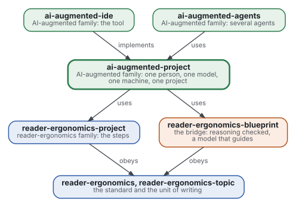
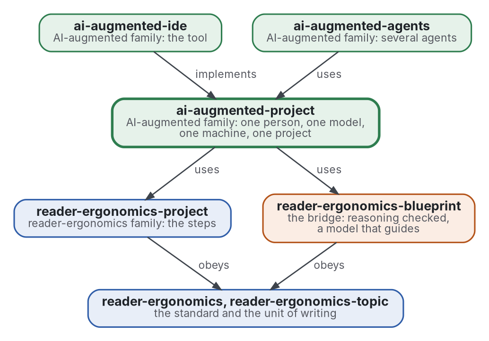

# Projet augmenté par l'IA

[](https://github.com/Tewf/ai-augmented-project/actions/workflows/checks.yml)
[](https://tewf.github.io/ai-augmented-project/)

Comment une **personne**, un **modèle de langue** et une **machine** sont mis en place et mènent un projet ensemble. La
machine vérifie, le modèle reçoit ses consignes et ses limites, et la personne garde les décisions qui sont les
siennes ; une boucle joint les trois. Les étapes du projet sont celles de [reader-ergonomics-project](https://github.com/Tewf/reader-ergonomics-project) ;
ce dépôt ajoute les deux parties qui ne sont pas la personne, et la mise en place de chacune.

Cette page en anglais : [README.md](README.md). Les deux versions suivent le même état.

> **État (2026-11-02) :** mis en place ; rien n'est encore écrit au-delà du périmètre. Le premier travail est une revue
> de littérature, non commencée. Le nom est provisoire jusqu'à ce que la première étape de cette revue dise comment le
> domaine nomme la chose. Ce n'est ni une norme officielle, ni une étude relue par des pairs, ni un résultat nouveau.
>
> **Comment il est fait :** avec Claude, un assistant IA d'Anthropic, sous la direction du mainteneur, comme
> reader-ergonomics. Les corrections sont bienvenues sous forme d'issues.

## Où il se place



<details>
<summary>Graphviz source</summary>



</details>

- **Il utilise [reader-ergonomics-project](https://github.com/Tewf/reader-ergonomics-project)** pour les étapes d'un
  projet, et **[reader-ergonomics-blueprint](https://github.com/Tewf/reader-ergonomics-blueprint/blob/f9b2408e7f1ddf4a82d2d480c62d6b5855e14e0b/README.md)** pour la boucle où un
  modèle interprète le verdict d'un vérificateur et ne décide rien. Le blueprint est épinglé par commit, faute de version
  publiée.
- **Il obéit à [reader-ergonomics](https://github.com/Tewf/reader-ergonomics/blob/b9732b9814c71768f722691f3c5049ec2b8ed378/standard.md)** (v1.19.2) et exécute ses vérifications en CI.
- **Il ne pointe que vers le bas.** La carte de la famille est [ai-augmented](https://github.com/Tewf/ai-augmented).

## Périmètre

| | Quoi | Pourquoi |
|---|---|---|
| dedans | mettre en place la machine : environnements, hooks, vérifications et CI comme oracle de ce qu'un programme peut décider | ce qu'un programme peut vérifier, un programme le vérifie, avant qu'un modèle ne le lise |
| dedans | mettre en place le modèle : ses consignes permanentes, sa mémoire entre sessions, ce qu'on lui remet au départ, ce qu'il peut décider | une question posée deux fois, ou une décision prise par le modèle, est le coût que ce dépôt existe pour réduire |
| dedans | mettre en place la personne : comment elle lit, quelles décisions sont les siennes, comment une question lui parvient, avec des options | le temps de la personne est la ressource rare |
| dedans | la boucle : qui fait quoi à chaque étape du projet, et ce qui est mesuré pour dire que le dispositif marche | sans mesure, un dispositif est une habitude |
| dehors | les étapes du projet elles-mêmes | [reader-ergonomics-project](https://github.com/Tewf/reader-ergonomics-project) |
| dehors | la vérification du raisonnement lui-même, Lean d'abord | [reader-ergonomics-blueprint](https://github.com/Tewf/reader-ergonomics-blueprint) |
| dehors | plusieurs modèles ou plusieurs personnes sur un projet | [ai-augmented-agents](https://github.com/Tewf/ai-augmented-agents) |
| dehors | le logiciel | [ai-augmented-ide](https://github.com/Tewf/ai-augmented-ide) |
| dehors | construire ou entraîner un modèle | d'autres le font ; ce dépôt en utilise un |

## Le premier travail : une revue de littérature

Non commencée. Elle suit l'ordre d'une revue de thèse, et elle est finie quand elle peut nommer la référence.

1. **Cadrer :** le problème en une phrase, et comment chaque domaine le nomme. Pistes à vérifier : human-AI teaming,
   génie logiciel assisté par l'IA, agentic coding, le harnais d'un agent de code. Le dépôt peut être renommé alors.
2. **Revue :** chaque nom, cherché par son nom académique, son acronyme et son auteur ; les synthèses d'abord.
   - la performance complémentaire : quand une personne avec un modèle bat chacun seul, et quand non ;
   - les conventions par lesquelles un projet instruit un agent de code, comme littérature grise : ce qu'elles tiennent, ce qui a été mesuré ;
   - la mémoire d'un modèle entre sessions, et son audit ;
   - les vérifications comme oracle : tests, hooks et CI comme premier lecteur de la sortie d'un modèle ;
   - ce que la revue du blueprint tient déjà sur un modèle qui interprète le verdict d'un vérificateur.
3. **État de l'art, et le dossier contre.**
4. **Positionnement :** ce que ce dépôt demande et que le domaine ne répond pas déjà.
5. **Référence :** le dispositif du mainteneur lui-même, écrit sans ses secrets, comparé à la meilleure pratique
   trouvée par la revue.

## Questions auxquelles la revue doit répondre

- **Décisions.** Quelles décisions reviennent à la personne, lesquelles à la machine, et que reste-t-il qu'un modèle
  puisse prendre ? La réponse du blueprint pour le raisonnement est : aucune ; vaut-elle pour tout un projet ?
- **Le début d'une session.** Que faut-il remettre à un modèle pour qu'aucune question ne soit posée deux fois, et
  comment garder cela assez court pour être lu ?
- **Mémoire.** Comment ce qu'un modèle retient entre sessions est-il conservé, qui peut l'écrire, et comment est-il audité ?
- **La mesure.** Que compte-t-on pour dire qu'un dispositif marche : allers-retours, temps, erreurs attrapées par une
  vérification avant qu'une personne ne les voie ?

## Vérifier

```sh
git clone https://github.com/Tewf/reader-ergonomics
python3 reader-ergonomics/checks/run.py chemin/vers/ce/depot
```

La CI exécute les mêmes vérifications à chaque push, et une exécution échoue à la première erreur
([checks.yml](https://github.com/Tewf/ai-augmented-project/blob/master/.github/workflows/checks.yml)). Chaque push sur
master construit aussi le site, [tewf.github.io/ai-augmented-project](https://tewf.github.io/ai-augmented-project/)
([pages.yml](https://github.com/Tewf/ai-augmented-project/blob/master/.github/workflows/pages.yml)).

## Contenu

| Partie | Résumé |
|---|---|
| [decisions](decisions/) | une fiche par choix qui façonne ce dépôt, chacune ouvrant sur la décision en une phrase |

## Licence

Code sous [Apache License 2.0](LICENSE) ; prose sous [CC BY 4.0](LICENSES/CC-BY-4.0.txt). Réutilisez-le comme vous le
souhaitez, en créditant ce dépôt ; [CITATION.cff](CITATION.cff) donne une citation si besoin.
