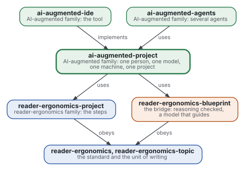
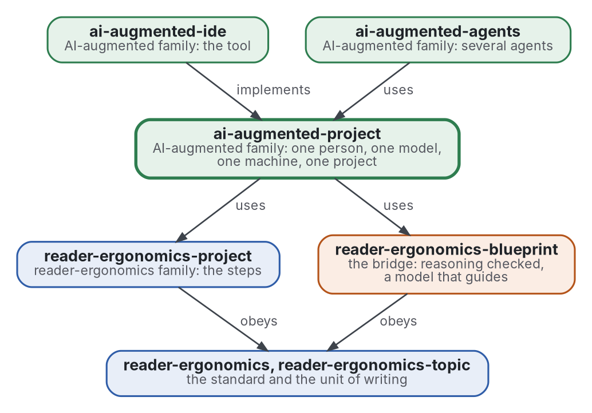

# AI-augmented project

[](https://github.com/Tewf/ai-augmented-project/actions/workflows/checks.yml)
[](https://tewf.github.io/ai-augmented-project/)

How a **person**, a **language model** and a **machine** are set up and run one project together. The machine checks,
the model is given its instructions and its limits, and the person keeps the decisions that are theirs; a loop joins
the three. The
steps of the project are those of [reader-ergonomics-project](https://github.com/Tewf/reader-ergonomics-project); this
repository adds the two parties that are not the person, and the setting of each.

This page in French: [README.fr.md](README.fr.md).

> **Status (2026-11-02):** set up; nothing is written yet beyond the scope. The first job is a literature review, not
> started. The name is provisional until that review's first step says what the field calls this. It is not an
> official standard, not a peer-reviewed study and not a new result.
>
> **How it is made:** with Claude, an AI assistant by Anthropic, under the maintainer's direction, the way
> reader-ergonomics was made. Corrections are welcome as issues.

## Where it sits



<details>
<summary>Graphviz source</summary>



</details>

- **It uses [reader-ergonomics-project](https://github.com/Tewf/reader-ergonomics-project)** for the steps of a project,
  and **[reader-ergonomics-blueprint](https://github.com/Tewf/reader-ergonomics-blueprint/blob/f9b2408e7f1ddf4a82d2d480c62d6b5855e14e0b/README.md)** for the loop in which a model
  interprets a checker's verdict and decides nothing. The blueprint is pinned by commit, since it has no release yet.
- **It obeys [reader-ergonomics](https://github.com/Tewf/reader-ergonomics/blob/b9732b9814c71768f722691f3c5049ec2b8ed378/standard.md)** (v1.19.2) and runs its checks in CI.
- **It links down only.** The family's map is [ai-augmented](https://github.com/Tewf/ai-augmented).

## Scope

| | What | Why |
|---|---|---|
| in | setting the machine: environments, hooks, checks and CI as the oracle of what a program can decide | what a program can check, a program checks, before any model reads it |
| in | setting the model: its standing instructions, its memory across sessions, what it is handed at the start, what it may decide | a question asked twice, or a decision taken by the model, is the cost this repository exists to cut |
| in | setting the person: how they read, which decisions are theirs, how a question reaches them, with options | the person's time is the scarce input |
| in | the loop: who does what at each step of the project, and what is measured to say the setup works | without a measure, a setup is a habit |
| out | the steps of the project themselves | [reader-ergonomics-project](https://github.com/Tewf/reader-ergonomics-project) |
| out | checking the reasoning itself, Lean first | [reader-ergonomics-blueprint](https://github.com/Tewf/reader-ergonomics-blueprint) |
| out | several models or several people on one project | [ai-augmented-agents](https://github.com/Tewf/ai-augmented-agents) |
| out | the software | [ai-augmented-ide](https://github.com/Tewf/ai-augmented-ide) |
| out | building or training a model | others do it; this uses one |

## The first job: a literature review

Not started. It follows the order of a thesis review, and it is finished when it can name the baseline.

1. **Frame:** the problem in one sentence, and what each field calls it. Leads to verify: human-AI teaming,
   AI-assisted software engineering, agentic coding, the harness of a coding agent. The repository may be renamed then.
2. **Review:** each name, searched by its academic name, its acronym and its author; surveys first.
   - complementary performance: when a person with a model beats either alone, and when it does not;
   - the conventions by which a project instructs a coding agent, as grey literature: what they hold, what was measured;
   - memory across sessions of a model, and its audit;
   - checks as the oracle: tests, hooks and CI as the first reader of a model's output;
   - what the blueprint's review already holds on a model that interprets a checker's verdict.
3. **State of the art, and the case against.**
4. **Position:** what this repository asks that the field does not already answer.
5. **Baseline:** the maintainer's own setup, written down without its secrets, compared with the best practice the
   review found.

## Questions the review must answer

- **Decisions.** Which decisions are the person's, which the machine's, and what is left that a model may take? The
  blueprint's answer for reasoning is none; does it hold for a whole project?
- **The start of a session.** What must a model be handed so that no question is asked twice, and how is it kept
  short enough to be read?
- **Memory.** How is what a model remembers across sessions kept, who may write it, and how is it audited?
- **The measure.** What is counted to say a setup works: round trips, time, errors caught by a check before a person
  saw them?

## Check it

```sh
git clone https://github.com/Tewf/reader-ergonomics
python3 reader-ergonomics/checks/run.py path/to/this/repository
```

CI runs the same checks on every push, and a run fails on any error
([checks.yml](https://github.com/Tewf/ai-augmented-project/blob/master/.github/workflows/checks.yml)). Every push to
master also renders the site, [tewf.github.io/ai-augmented-project](https://tewf.github.io/ai-augmented-project/)
([pages.yml](https://github.com/Tewf/ai-augmented-project/blob/master/.github/workflows/pages.yml)).

## Contents

| Part | Summary |
|---|---|
| [decisions](decisions/) | one record per choice that shapes this repository, each opening with the decision in one sentence |

## Licence

Code under the [Apache License 2.0](LICENSE); prose under [CC BY 4.0](LICENSES/CC-BY-4.0.txt). Reuse it as you wish,
with credit to this repository; [CITATION.cff](CITATION.cff) gives a citation if you need one.
