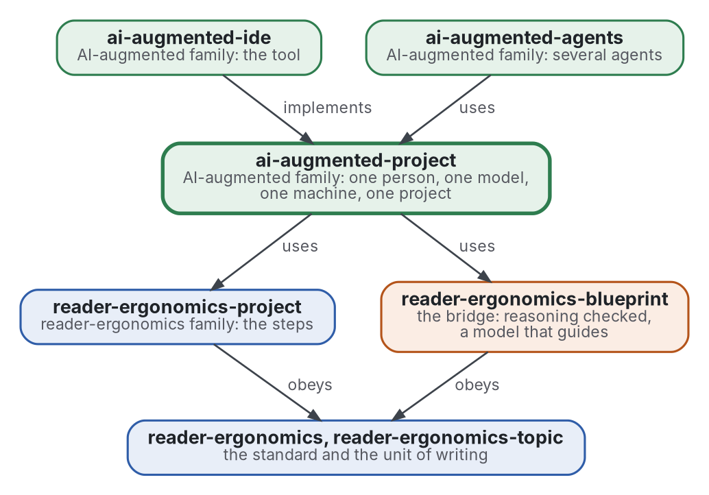

# AI-augmented project

[](https://github.com/Tewf/ai-augmented-project/actions/workflows/checks.yml)
[](https://tewf.github.io/ai-augmented-project/)

How a **person**, a **language model** and a **machine** are set up and run one project together. The machine checks,
the model is given its instructions and its limits, and the person keeps the decisions that are theirs; a loop joins
the three. The
steps of the project are those of [reader-ergonomics-project](https://github.com/Tewf/reader-ergonomics-project); this
repository adds the two parties that are not the person, and the setting of each.

This page in French: [README.fr.md](README.fr.md).

> **Status (2026-11-03):** the first job, a first-pass literature review of 39 sources, is written and ends on a named
> baseline. The design document is written and proposed; it awaits the maintainer's approval. The name is kept; the field's word is human-AI teaming. It is not an
> official standard, not a peer-reviewed study and not a new result.
>
> **How it is made:** with Claude, an AI assistant by Anthropic, under the maintainer's direction, the way
> reader-ergonomics was made. Corrections are welcome as issues.

## Where it sits


<details>
<summary>Graphviz source</summary>



</details>

- **It uses [reader-ergonomics-project](https://github.com/Tewf/reader-ergonomics-project)** for the steps of a project,
  and **[reader-ergonomics-blueprint](https://github.com/Tewf/reader-ergonomics-blueprint/blob/f9b2408e7f1ddf4a82d2d480c62d6b5855e14e0b/README.md)** for the loop in which a model
  interprets a checker's verdict and decides nothing. The blueprint is pinned by commit, since it has no release yet.
- **It obeys [reader-ergonomics](https://github.com/Tewf/reader-ergonomics/blob/b9732b9814c71768f722691f3c5049ec2b8ed378/standard.md)** (v1.19.2) and runs its checks in CI.
- **It links down only.** The family's map is [ai-augmented](https://github.com/Tewf/ai-augmented).

## Scope

| | What | Why |
|---|---|---|
| in | setting the machine: environments, hooks, checks and CI as the oracle of what a program can decide | what a program can check, a program checks, before any model reads it |
| in | setting the model: its standing instructions, its memory across sessions, what it is handed at the start, what it may decide | a question asked twice, or a decision taken by the model, is the cost this repository exists to cut |
| in | setting the person: how they read, which decisions are theirs, how a question reaches them, with options | the person's time is the scarce input |
| in | the loop: who does what at each step of the project, and what is measured to say the setup works | without a measure, a setup is a habit |
| out | the steps of the project themselves | [reader-ergonomics-project](https://github.com/Tewf/reader-ergonomics-project) |
| out | checking the reasoning itself, Lean first | [reader-ergonomics-blueprint](https://github.com/Tewf/reader-ergonomics-blueprint) |
| out | several models or several people on one project | [ai-augmented-agents](https://github.com/Tewf/ai-augmented-agents) |
| out | the software | [ai-augmented-ide](https://github.com/Tewf/ai-augmented-ide) |
| out | building or training a model | others do it; this uses one |

## The first job: a literature review

A first pass of 39 sources, 30 formal and 9 grey, in the five steps of a thesis review:
[frame](evidence/human-ai-teaming/frame.md), [review](evidence/human-ai-teaming/review.md),
[state of the art](evidence/human-ai-teaming/state-of-the-art.md), [position](evidence/human-ai-teaming/position.md)
and [baseline](evidence/human-ai-teaming/baseline.md). The [evidence](evidence/) folder holds all of it.

## What the review found

- **The field's name is human-AI teaming.** The aim is hybrid intelligence; the test is complementary performance.
  "AI-augmented" echoes augmentation, so the name is close and is kept.
- **A person with a model does not beat the better of the two on average**: g = -0.23 over 106 experiments.
  Tasks that decide lost; tasks that create gained (Vaccaro 2024). Measured.
- **A context file does not raise success and costs over 20% more on average**; it helps to state non-standard practice
  (Gloaguen 2026). A stale file is obeyed over the code in 90.1% of choices (Xu 2026, secondary). Measured.
- **Speed results disagree.** Experienced developers were 19% slower while believing they were faster
  (Becker 2025); two other trials found about 21% and 55.8% faster (secondary). Self-report is not a measure.
- **No controlled study was found** of a model-written project memory, of its audit, or of round trips as a measure.
  That is a statement about these searches.

## The baseline

**B1** is the maintainer's practice, written down for this review ([baseline](evidence/human-ai-teaming/baseline.md)).

- standing instructions loaded each session;
- one shared memory, with one fact per file;
- checks as the oracle;
- delegation by cost;
- questions to the person, with options.

It lacks a measure, a staleness test and a control.
The [position](evidence/human-ai-teaming/position.md) listed four points for the design document to decide: the unit
of measure and the control, where the person's decisions are logged, which checks are programs, and how a program
finds stale instructions. The design document decides them.

## The design document

[design/one-project.md](design/one-project.md) is proposed on 2026-11-03, with a record per choice.

- **Decisions** ([0003](decisions/0003-the-model-decides-nothing-unchecked.md)): the person decides what is built and
  which checks count, the machine decides pass or fail, and the model decides nothing unchecked.
- **The start of a session** ([0004](decisions/0004-a-short-start-file-and-an-index.md)): a start file and a memory
  index, each at most 200 lines (provisional), and the brief of the task, and nothing else.
- **The brief** ([0008](decisions/0008-a-task-is-handed-over-as-a-brief-that-names-its-checks.md)): four parts, task,
  what is decided, what is to be found and the checks it is judged by.
- **Memory** ([0005](decisions/0005-memory-is-plain-files-with-a-source.md)): one fact per file, each with a source a
  program follows; one sentence gives the code precedence over a stale file.
- **The measure** ([0006](decisions/0006-the-task-is-the-unit-and-three-arms-the-control.md)): five counts per task,
  and a case compares the person alone, the model alone and both.
- **The editor extension** ([0007](decisions/0007-the-extension-reads-files-and-hands-over-two.md)): it keeps no
  state, shows the files, and hands the model the start file and the index.

## Questions the review answered

The answers are in [position](evidence/human-ai-teaming/position.md).

- **Decisions.** Which decisions are the person's, which the machine's, and what is left that a model may take? The
  blueprint's answer for reasoning is none; does it hold for a whole project?
- **The start of a session.** What must a model be handed so that no question is asked twice, and how is it kept
  short enough to be read?
- **Memory.** How is what a model remembers across sessions kept, who may write it, and how is it audited?
- **The measure.** What is counted to say a setup works: round trips, time, errors caught by a check before a person
  saw them?

## Check it

```sh
git clone https://github.com/Tewf/reader-ergonomics
python3 reader-ergonomics/checks/run.py path/to/this/repository
```

CI runs the same checks on every push, and a run fails on any error
([checks.yml](https://github.com/Tewf/ai-augmented-project/blob/master/.github/workflows/checks.yml)). Every push to
master also renders the site, [tewf.github.io/ai-augmented-project](https://tewf.github.io/ai-augmented-project/)
([pages.yml](https://github.com/Tewf/ai-augmented-project/blob/master/.github/workflows/pages.yml)).

## Contents

| Part | Summary |
|---|---|
| [evidence](evidence/) | the first-pass review: 39 sources, five steps, ending on the baseline B1 |
| [design](design/one-project.md) | the design document: five decisions, their alternatives, the measure and the extension's interface |
| [decisions](decisions/) | one record per choice that shapes this repository, each opening with the decision in one sentence |

## Licence

Code under the [Apache License 2.0](LICENSE); prose under [CC BY 4.0](LICENSES/CC-BY-4.0.txt). Reuse it as you wish,
with credit to this repository; [CITATION.cff](CITATION.cff) gives a citation if you need one.
