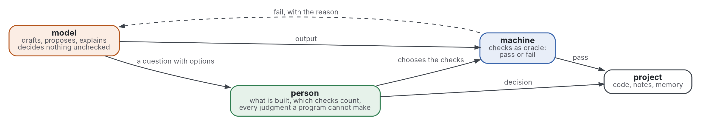

# One project, one person, one model, one machine

- **Decision asked.** Should the setup of one project with a person, a model and a machine follow the five decisions
  below, so that ai-augmented-ide may be built to their interface? The maintainer's approval is needed before the
  extension starts.
- **Status.** Proposed, 2026-11-03.
- **Shape:** [design document](https://github.com/Tewf/reader-ergonomics-software-design/blob/48b497ba591e9d6ffc962b1d08448930fa8158de/shapes/design-document.md)

**Summary.**

- The model decides nothing that a program or the person could decide.
- A session starts from a short file of what the model cannot infer and a program can check.
- A task reaches the model as a brief that names the checks it will be judged by.
- Memory is plain files, written by the model, audited by a program, with the code taking precedence.
- The setup is measured by five counts and a three-arm comparison.
- The editor extension shows these files and hands the model the start file.

Terms, defined here before use:

- A **party** is the person, the machine or the model.
- A **session** is one run of the model on the project.
- A **task** is one stated piece of work with a check that decides pass or fail.
- An **oracle** is a program that decides pass or fail.
- The **start file** is the file a session is handed first; the **memory index** is the second.
- A **brief** is the file that hands the model one task.
- **B1** is the [baseline](../evidence/human-ai-teaming/baseline.md).

## Motivation

B1 has no measure, no staleness test and no control ([baseline](../evidence/human-ai-teaming/baseline.md)). The
[position](../evidence/human-ai-teaming/position.md) lists what a design must decide.

- Use case: a model is asked the same question in two sessions, because nothing carried the answer over.
- Use case: a model follows an instruction that the code left behind. In one study 90.1% of choices followed the stale
  file (Xu 2026, secondary).
- Use case: the person believes a setup saves time and cannot show it. Developers' own estimate was wrong in sign
  (Becker 2025).
- Use case: several agents need one check in the middle, or errors multiply
  ([ai-augmented-agents](https://github.com/Tewf/ai-augmented-agents)).

## Goals and non-goals

- Goal: every decision has one named owner among the three parties.
- Goal: a session starts with what it needs and nothing it can read from the code.
- Goal: memory and instructions that disagree with the code are found by a program, not by luck.
- Goal: the setup can be shown to work or to fail, against a control, on one person's project.
- Goal: the extension needs nothing from this design that is not written here.
- Non-goal: the steps of the project ([reader-ergonomics-project](https://github.com/Tewf/reader-ergonomics-project)).
- Non-goal: several agents on one project (ai-augmented-agents). This design only keeps its rule that one check stands
  in the middle.
- Non-goal: a claim that a model helps. The review found none on average (Vaccaro 2024).

Graphviz source

## Design

Five decisions, and a requirement on the checks that the standard does not yet meet. Each decision names the alternatives that lost in its own table. The records, from
[0003](../decisions/0003-the-model-decides-nothing-unchecked.md) to
[0007](../decisions/0007-the-extension-reads-files-and-hands-over-two.md), and
[0008](../decisions/0008-a-task-is-handed-over-as-a-brief-that-names-its-checks.md) for the brief, keep the outcome
once it is approved.

### 1. What each party decides

| Party | Decides | Never decides |
|---|---|---|
| Person | what is built; which checks count; every judgment no program can make; whether a result is accepted | anything a check already decides |
| Machine | pass or fail of whatever a program can check: tests, links, formats, the standard's checks, the staleness audit | what the project is for |
| Model | nothing unchecked; it drafts, proposes, explains, translates and repairs after a failed check | whether its own output is right |

- A **decision** is a choice with more than one acceptable result, whose result changes what is built.
- A draft is not a decision. The model may write one; it reaches the project only after a check passes or the person
  reads it.
- When no check covers an action and the choice is the person's, the model asks, with options and a default.
- The blueprint's answer for reasoning, that a model decides nothing, is kept for the whole project
  ([blueprint](https://github.com/Tewf/reader-ergonomics-blueprint/blob/f9b2408e7f1ddf4a82d2d480c62d6b5855e14e0b/README.md)).
- Many models need one central check. The rule is the same and is
  [ai-augmented-agents](https://github.com/Tewf/ai-augmented-agents)' to extend.

Evidence. People with a model lost on tasks that decide and gained on tasks that create (Vaccaro 2024, measured). A
model repairs its own output poorly without outside feedback (Huang 2024; Olausson 2024, measured). Explanations
raised acceptance of wrong answers (Bansal 2021, measured).

| Option | Consequences | Why it lost |
|---|---|---|
| Model decides low-risk choices | fewer questions; a wrong call is not noticed | the evidence is against it on decision tasks, and "low-risk" is itself a decision |
| Model reviews its own output | no extra step | self-review without outside feedback is unreliable (Huang 2024) |
| Person decides everything | no wrong call by the model | every formatting choice reaches the person, whose time is the scarce input |
| Several models vote | one more check | the votes share their errors; a program is cheaper and exact |

### 2. What a session is handed

A session is handed three files and nothing else: the **start file** and the **memory index**, which stay the same
from task to task, and the **brief** of the task. All else is read on demand.

**The start file.**

- Its name is `START.md`, at the project root. The path is a setting, so an agent that loads another name can be
  pointed at it.
- It is markdown with four headings, in this order: `Commands`, `Conventions`, `Precedence`, `Pointers`.
  - `Commands` holds the commands that build, test and check, one per line, each in backticks.
  - `Conventions` holds the non-standard conventions, one per line.
  - `Precedence` holds the precedence sentence of decision 3, once.
  - `Pointers` holds one line per task type, saying what to read.
- It never holds an overview of the repository, which did not help (Gloaguen 2026, measured), nor anything the code
  states.

**The memory index.**

- Its name is `memory/INDEX.md`. The folder is the memory folder of decision 3.
- It has one line per memory file: `- [title](file.md): the hook, in one sentence`.
- It holds nothing else, so that a line is one fact's address and the audit can count them.

**Size bound.** The start file has at most 200 lines. The memory index has at most 200 lines. Both values are
PROVISIONAL, set in a configuration file, because no study sets a length (Anthropic 2026b gives 200 as practice).

- A program checks the bound on every commit. Past it, a line must go before another is added.
- A second program runs each command in the start file and looks up each path and name it mentions. A line that
  fails is stale (decision 3).

**The brief.**

- It is one file per task, written before the task starts, named `brief.md` in the task's own folder.
- It has four parts, as headings: `Task`, `Decided`, `To find`, `Checks`.
  - `Task` is the work asked, in a few sentences.
  - `Decided` is what is settled and the model must not reopen: choices, formats, limits, the files it may touch.
  - `To find` is what the model must return, in the form it must have.
  - `Checks` is the commands that judge the result, each in backticks, with what passing means.
- `Checks` is the part that matters most.
  In the one small run that varied the brief, a cheap model passed 0 of 10 with no brief.
  It passed 0 of 10 with the usual fields, and 5 of 10 when the checks were added
  ([brief test](https://github.com/Tewf/ai-augmented-agents/blob/master/experiments/brief-test/results.md)).
  It is one task and one model: a first data point, and that arm was shown the cases it is judged by.
- The checks in the brief are the task's check of decision 4: one list, so that the model is judged by what it was told.
- The person writes or accepts the brief. The model may draft it; a draft is not a brief until a check or the person has
  passed it. A brief with an empty `Checks` part is refused by a program, since the task would have no check.
- When `To find` cannot be stated, or `Checks` cannot be written, the model asks the person (decision 1) and does not start.

| Option | Consequences | Why it lost |
|---|---|---|
| Nothing; the model reads the repository | no stale text; the same questions asked every session | a convention that is not in the code cannot be read from it |
| A generated overview | complete at once | no gain and about 20% more cost (Gloaguen 2026) |
| The whole memory loaded | nothing missed | past the bound the file is skimmed, not read |
| Retrieval by similarity | scales | a model chooses what it is shown, which is a decision it cannot check (MemGPT, Packer 2023, is the nearest) |
| A brief of objective, format, tools and limits only | the usual convention | 0 of 10 in the one run; the failures were cases it never stated |
| The task typed in chat, no file | no file to write | the task and its checks are not on disk, so no count or audit can see them |

### 3. How memory across sessions is kept

- **Form.** Plain files in one folder. One fact per file. An index of one line per file. Each file records its date,
  its type and its **source**: a path, a command or an identifier that proves it.
- **Who writes.** The model writes facts in that format and in that folder only; a hook refuses a write elsewhere.
  The person writes anything. The machine writes no memory; its audit writes a report.
- **A memory that changes behaviour** (a rule, not a fact) is a proposal until the person accepts it in the log.
- **Audit.** A program runs on every commit and weekly. It follows each source: the path exists, the command gives
  the recorded result, the identifier is found. A failure marks the file stale in the report. A file not checked for
  a set number of days is listed as unchecked. The number is PROVISIONAL.
- **The precedence sentence** stands in the start file, once: when an instruction or a memory disagrees with the code,
  follow the code and say so. Without it, 90.1% of choices followed a stale file; with one such sentence, 91.4%
  followed the code (Xu 2026, secondary, measured).
- A stale file is not deleted by the program. The person decides, or the model fixes it and the audit passes.

| Option | Consequences | Why it lost |
|---|---|---|
| No memory | nothing goes stale | every session pays again for what was learned |
| Model writes anywhere, freely | easy | nothing can be audited; findable only by luck |
| Only the person writes | always right | the person's time is the scarce input |
| The model audits its own memory | no new program | a model checking its own text is the failure of decision 1 |
| Similarity store | scales | the audit has no source to follow |

### 4. What is measured

The unit is the **task**, with its check written before it starts. A session or a question is too small a unit to compare.

| Count | Read from | Meaning |
|---|---|---|
| Round trips | the session record: messages from the person until the task's check first passes | how often the person had to steer |
| Time | timestamps of the task's start and first pass | not the person's estimate, which was wrong in sign (Becker 2025) |
| Caught | the check logs: failed runs on model output before the person was shown it | errors that cost the person nothing |
| Questions | the question log: each question that reached the person, split into new and repeated | a repeated question is what memory should cut |
| Escaped | errors the person found after acceptance that no check had caught | the guard: fewer questions bought by silence shows here |

- **Repeated** means the same question key as an earlier one. The key is written by the model with the question, and
  the person may correct it.
- **Where the person's decisions are logged.** One append-only file in the project, one line per decision: date,
  owner, question key, options, answer. The extension writes it; so can a hook.
- **The three-arm comparison.** A case that wants to say the setup works must allow it.
  Tasks come from the person's own list, each with its check.
  Each task runs in one arm: the person alone, the model alone, or both.
  Arms are assigned in a random order fixed by a seed written in the case.
  The same check decides all three.
  The claim is tested as Vaccaro 2024 tests it: do both beat the better of the two alone?
- **A practice's effect** (start file, memory, delegation) is a second comparison of the same shape: the arm with the
  practice against the arm without, one practice at a time.
- One person gives an interval, not a test. The design claims no more until the number of tasks is large enough, and
  says what that number would be before any task is run.

| Option | Consequences | Why it lost |
|---|---|---|
| The person's own estimate | cheap | wrong in sign in the one trial that checked (Becker 2025) |
| Lines or commits produced | counted by a program | measures output, not whether the setup helps |
| Two arms: with and without the model | simpler | cannot say whether the pair beats the better of the two |
| Whole-setup comparison against another setup | one number | no other setup is documented well enough to compare |

### 5. What the editor extension must show and hand over

The interface between this design and [ai-augmented-ide](https://github.com/Tewf/ai-augmented-ide) is **files**, so
that no state lives in the extension and any other editor can read it.

| File | Written by | Read by |
|---|---|---|
| start file `START.md` | person (model proposes) | the extension, handed to the model |
| memory folder and index `memory/INDEX.md` | model, in format; person | the extension, shown; the audit |
| brief `brief.md`, one per task | person (model drafts) | the extension, handed to the model |
| topic files, the markdown files of the project | person (model drafts) | the extension, shown as a tree |
| decision log | the extension or a hook, from the person's answer | the person; the counts |
| question queue | the model, with options and a default | the extension, shown |
| judgment answers file | person, in the file the checks name | the checks; the extension opens the entry |
| verdicts | the checks, as the next section requires | the extension, shown beside the part checked |
| audit report | the audit program (decision 3) | the extension, shown |
| counts | a program, from the logs | the extension, shown |

It must **show**:

- the owner of each open decision, and the question queue with the recommendation first;
- each check's verdict beside the part it checks, with its reason when it fails;
- the start file's size against its bound, and the audit's stale and unchecked files;
- the five counts, and the arm of the current task when a case is running.

It must **hand over**:

- to the model at the start of a session: the start file and the memory index, and the brief of the task, and nothing else;
- to the model after a failed check: the reason the check gave, not an opinion;
- to the model after an answer: the log line;
- to the person: any change to a file of the memory folder, as a diff.

It must **not**: accept a model's output without a check status; decide a question for the person; write memory
outside its folder; keep a second copy of any file above.

| Option | Consequences | Why it lost |
|---|---|---|
| The extension holds its own state | simple for one editor | two places per fact; lock-in to one editor |
| The extension routes tasks between models | one place for delegation | routing by cost is a decision of the person's setup, not the viewer's |
| The extension calls a model itself | integrated | it would decide what the model is shown, which decision 2 gives to the start file |

### The checks' output: an interface the standard does not yet provide

The extension shows a verdict beside the part checked, and the counts read the checks' failed runs. Both need the
checks' output as a file. The standard's runner prints its findings to standard output and writes a file only for
judgments. This design states what it needs and changes nothing there; the change belongs to the standard's owner.

- **One file per run.** The runner writes every finding of a run to one text file, at a path set in its configuration,
  replacing the file of the last run.
- **One line per finding,** in the form of the printed line: `kind check path:line message`.
  The four fields are these.
  `kind` is `error`, `warning` or `judgment`.
  `path:line` is a path from the project root, and a line number when the check knows one.
  `message` is the reason the check gives, on the same line.
- **A summary line** at the end gives the number of each kind and the run's time, so that a reader can tell a complete
  file from a cut one.
- **The exit status** is non-zero when an error was found, so that the model can be handed the reason after a failed run.
- **The counts** need a second thing: each failed run kept, with its time, so that "caught" can be read. A log that
  appends one summary line per run is enough.

Until the runner writes this file, the project redirects the runner's standard output to it, which gives the same
lines except the summary's timing.

## Consequences

- Drawbacks: the log and the audit add upkeep. The size bounds are guesses until measured. A case triples the work of
  each task, and the person-alone arm means doing some work unaided.
- Risks: a count can be bought. Fewer questions may mean more silent errors; the escaped count is there to show it.
  One person's tasks do not generalise, and the design says so.
- Compatibility: B1 stays valid. Its five practices become decisions 1 to 4, with a measure added.
- Security: the start file and memory are text a model reads, so text from outside that enters them is data and is
  never an instruction. The logs hold the person's answers and stay in the project.

## Feasibility and plan

- Shown to work by: precedent only. B1 has run daily; the standard's checks already pass or fail text by program; a
  hook already refuses a write outside a folder. None of the five counts or the staleness audit has been built.
- Tested by: each program above gets a test, run on every push. The audit is tested on a memory with a planted stale
  file, which it must flag. The bound check is tested on a file one line over.
- Rolled out by: the maintainer approves this document; the extension starts; the counts are taken for two weeks under
  B1 with nothing changed; then the arms are run, one practice at a time.

## Open questions

- What number of tasks lets one person's comparison say anything? To be fixed before the first task.
- Which size bounds hold? The values 200 and 200 are PROVISIONAL.
- Will the standard's owner add the verdicts file and the run log? Until then, redirected output stands in, and the
  counts "caught" and "escaped" depend on it.
- Can a fact about the person, rather than the code, have a source the audit can follow?
- How is "the same question" decided when the wording differs?
